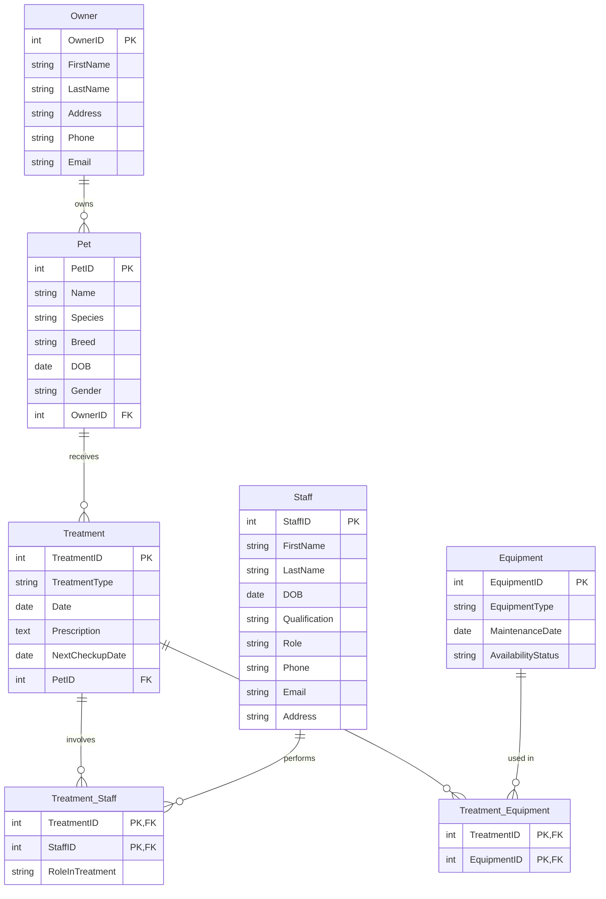
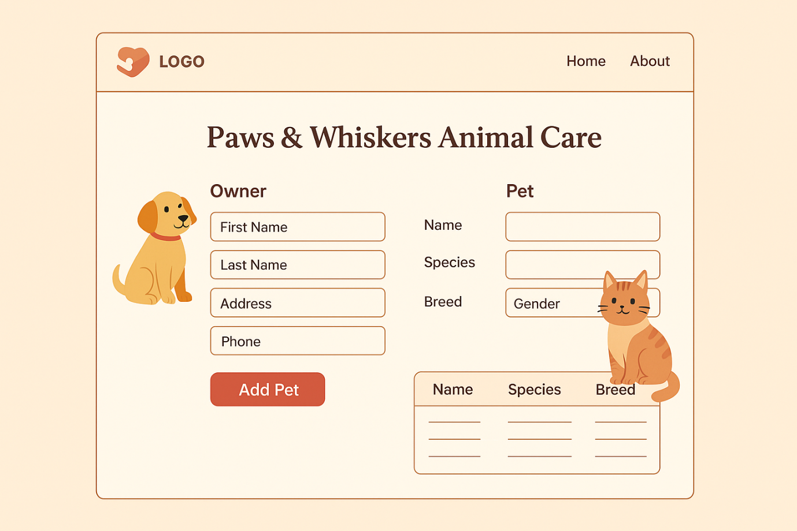
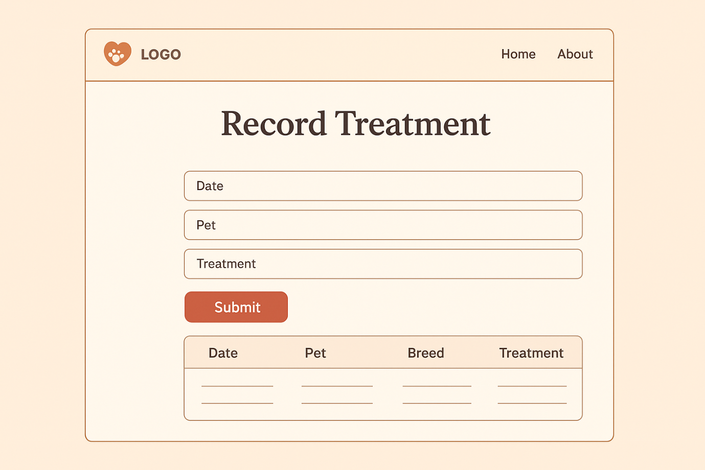
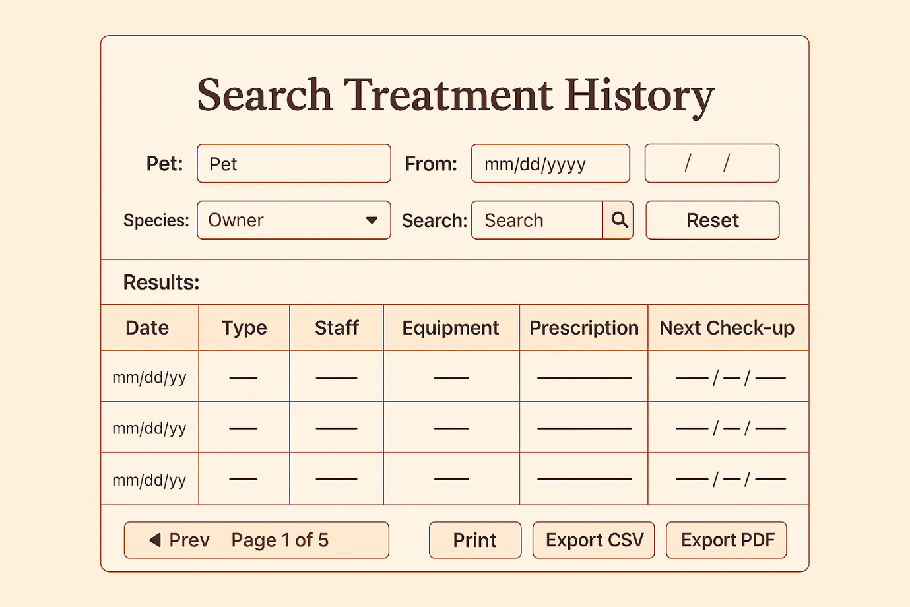

# 🐾 Paws & Whiskers Vet Clinic Database

A relational **MySQL** database design for **Paws & Whiskers Animal Care**, a veterinary clinic. It stores owners, pets, staff, treatments, and equipment, and supports common clinic tasks such as booking treatments and searching a pet's history.


## 📌 Project Overview

Completed for **Unit 4: Database Design and Development** (Pearson BTEC HND in Computing). The clinic needed one organised system in place of scattered records, so that staff can quickly find pet details, treatment history, and follow-up dates.

## 🗂️ Database Design

**7 tables:** 5 entity tables and 2 junction tables that resolve many-to-many relationships.

| Table | Purpose |
|---|---|
| `Owner` | Pet owners and contact details |
| `Pet` | Pets, linked to one owner |
| `Staff` | Clinic staff, roles, and qualifications |
| `Treatment` | Treatments given to pets, with prescription and next check-up date |
| `Equipment` | Clinic equipment, maintenance date, and availability |
| `Treatment_Staff` | Links treatments and staff (many-to-many) |
| `Treatment_Equipment` | Links treatments and equipment (many-to-many) |

### Entity relationship diagram



### Design decisions

- **Junction tables** let one treatment involve several staff and equipment items, and let staff and equipment appear in many treatments.
- **Composite primary keys** on the junction tables prevent duplicate links.
- **Foreign keys** keep data consistent: a pet must have a valid owner, and a treatment must belong to a valid pet.
- **Safe deletion:** child rows (`Treatment_Staff`, `Treatment_Equipment`) must be removed before a treatment. Deleting the parent first fails with a foreign key error, which protects data integrity.
- **NOT NULL** constraints on essential fields such as names and treatment dates.

## ▶️ How to Run

1. Open **MySQL Workbench** or **phpMyAdmin**.
2. Run [`sql/schema.sql`](sql/schema.sql) to create the database and tables.
3. Run [`sql/sample-data.sql`](sql/sample-data.sql) to load a small made-up dataset.
4. Try the statements in [`sql/queries.sql`](sql/queries.sql).

## 🔍 Example Queries

```sql
-- Dogs owned by people in York
SELECT p.Name AS Pet, o.FirstName, o.LastName
FROM Pet p
JOIN Owner o ON p.OwnerID = o.OwnerID
WHERE p.Species = 'Dog' AND o.Address LIKE '%York%';

-- Number of pets per species
SELECT Species, COUNT(*) AS PetCount
FROM Pet
GROUP BY Species;

-- Frequent patients: pets with more than 3 treatments
SELECT PetID, COUNT(*) AS NumTreatments
FROM Treatment
GROUP BY PetID
HAVING COUNT(*) > 3;
```

More are in `queries.sql`: inserts, updates, safe deletes, `BETWEEN`, `IN`, `ORDER BY`, `GROUP BY`, `HAVING`, and joins.

## 🖼️ Interface Mockups

Design mockups for the screens staff would use. These are designs only, not a built application.





## 🚧 Limitations and Next Steps

- The project covers database design and SQL only. The screens are mockups, and no front-end application was built.
- The sample data is illustrative and does not come from a real clinic.
- Possible next steps: add indexes, views for common reports, role-based access for staff, and a simple web or Python front end.

## 📂 Repository Contents

| File | Description |
|---|---|
| `sql/schema.sql` | Creates the database and 7 tables |
| `sql/sample-data.sql` | Small illustrative dataset |
| `sql/queries.sql` | Example operations and reporting queries |
| `images/` | Interface mockups |
| `report/` | Database report |

## 👤 Author

**Afry Nizam**: BSc Information Technology student, University of West London
[LinkedIn](https://www.linkedin.com/in/afrynizam) · [GitHub](https://github.com/afrynizam07)
